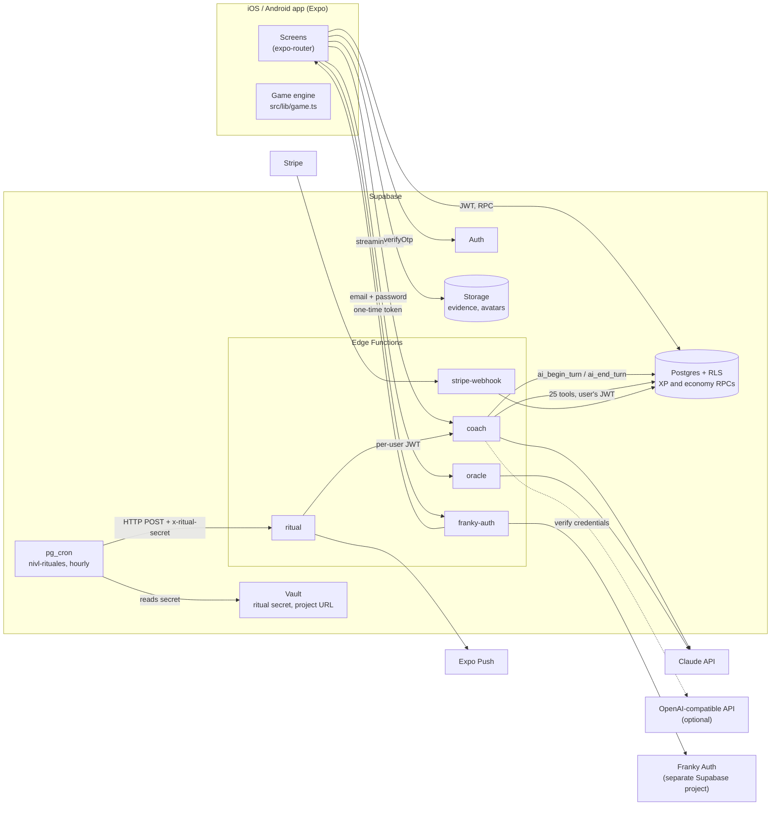
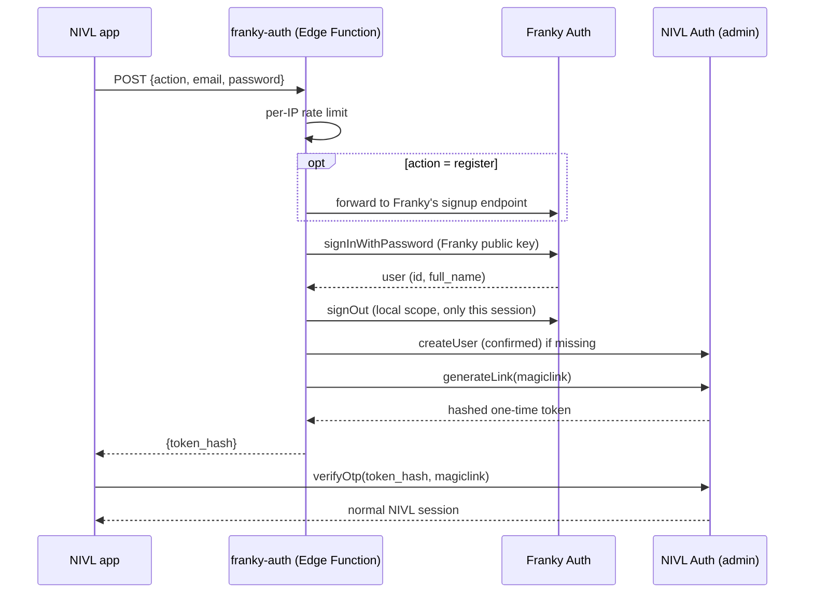

<p align="center">
  
</p>

<h1 align="center">NIVL</h1>

<p align="center">
  A gamified habit app with an AI coach that plans your day and reviews your week.
</p>

<p align="center">
  <a href="https://apps.apple.com/es/app/nivl/id6801825007"></a>
  
  
  
</p>

---

NIVL turns real life into a game. Habits are **missions** that pay XP, XP builds **levels and ranks**, consistency builds a **streak** multiplier, and long projects are **campaigns** with a final boss. You can add friends by code and compete on a weekly board.

On top of the game sits an **AI coach** that does more than chat: it reads your real data, writes your day plan hour by hour, creates and adjusts missions, logs what you tell it, and runs scheduled rituals: a morning brief, a Sunday review, a monthly close, and a check-in when you go quiet.

The app is in Spanish and is live on the [App Store](https://apps.apple.com/es/app/nivl/id6801825007). Accounts are shared with [Franky](https://franky.es) through a single sign-on bridge.

## Tech stack

| Layer | What's used |
|---|---|
| App | Expo SDK 54, React Native 0.81, strict TypeScript, expo-router, Reanimated, expo-notifications, expo-secure-store |
| Backend | Supabase: Postgres with row-level security, Auth, Storage, Edge Functions (Deno), pg_cron + pg_net, Vault |
| AI | Claude API (Sonnet for the coach, Haiku for cheap mechanical tasks), plus an OpenAI-compatible adapter so a plan can be routed to another provider |
| Payments | Plan tiers (free, Pro, Élite) and AI budgets enforced in Postgres. A Stripe webhook exists; the in-app purchase layer (`src/lib/pro.ts`) is an abstraction prepared for RevenueCat (see [Branch status](#branch-status)) |
| Quality | Jest (18 test files for the game engine and pure logic), `tsc --noEmit` and Jest in GitHub Actions on pull requests and pushes to `main`/`master` |

## Architecture



Key ideas:

- **The server owns the economy.** XP is only granted through Postgres functions (`award_xp`, `complete_quest`, `apply_day_close`) that apply atomic, idempotent deltas. Direct updates to the economy columns are revoked (`0009_economia_atomica.sql`).
- **AI keys never reach the phone.** The coach client sends only the session JWT; the Anthropic key lives as an Edge Function secret.
- **Every AI turn passes a spend lock.** `ai_begin_turn` checks, in one transaction, that the account is entitled, that it has budget left this month (measured in micro-dollars of real token cost), and that no other turn is running.

More detail on the data model and each function is in [docs/ARCHITECTURE.md](docs/ARCHITECTURE.md).

## How the AI coach works

The coach lives in [`supabase/functions/coach`](supabase/functions/coach/index.ts). It's an agent with tools, not a chat proxy.

1. **Gate.** The function validates the JWT and calls `ai_begin_turn`. If the plan has no AI, the monthly budget is spent, or another turn is in flight, it returns 402/429 before reading the body. If the check itself fails, the request is refused (fail closed).
2. **Context.** It builds a layered system prompt ([`_shared/prompt.ts`](supabase/functions/_shared/prompt.ts)): the coach's voice and rules, domain knowledge on training and nutrition, the user's long-term memory (`coach_dossier`), the instruction for this ritual, and today's state. The state includes a deterministic "study" ([`_shared/analytics.ts`](supabase/functions/_shared/analytics.ts), [`_shared/finance.ts`](supabase/functions/_shared/finance.ts)) with estimated 1RM, trends, and spending, so the model reasons over computed numbers instead of doing arithmetic itself. The whole system block is marked for prompt caching.
3. **Tool loop.** The model can call 25 tools ([`_shared/tools.ts`](supabase/functions/_shared/tools.ts)), such as `crear_mision`, `planificar_dia`, `programar_evento`, `registrar_hecho`, `prescribir_entreno`, `registrar_movimiento`, `escribir_diario`, and `consultar_historial`. Tools run with **the caller's JWT**, so row-level security still applies even if the model makes up an id. The model picks a mission's difficulty; the XP comes from a fixed table.
4. **Limits.** At most 5 tool iterations, a 100-second wall-clock budget (Edge Functions are cut at about 150 s), a 12-message history window (long-term memory goes to `coach_facts` and the dossier instead), and a per-turn cost brake.
5. **Ledger.** Each turn writes its model, token counts, and cost to `coach_runs`. Those rows are what the monthly budget is measured against.

Model routing comes from the plan (`ai_plans.routes`, migration 0024). A `claude-*` model goes to Anthropic; any other name goes through the OpenAI-compatible adapter ([`_shared/openai.ts`](supabase/functions/_shared/openai.ts)), which translates Anthropic-style tool calls both ways.

### Scheduled rituals (pg_cron)

Migration [`0010_cron_rituales.sql`](supabase/migrations/0010_cron_rituales.sql) schedules `nivl-rituales` every hour. It reads a secret from Vault and POSTs to the `ritual` function, which checks the user's local time and decides what to run:

| Ritual | When (user's timezone) |
|---|---|
| `brief`: yesterday's verdict, today's orders, and the full day plan | at wake-up time |
| `revision_semanal`: weekly review, at most 4 mission adjustments | Sunday, 20:00 |
| `cierre_mensual`: month vs. goals, plus a photo recap | day 1, at wake-up time |
| `escalada`: a check-in offering three options | 11:00, after 4 days without a message (at most once a week) |

Accounts without AI or with too little budget left are skipped. The result is sent as an Expo push notification, summarized to one line by Haiku.

## Single sign-on with Franky

NIVL and Franky run on **separate Supabase projects** with incompatible schemas, so a Franky JWT is not valid in NIVL. The [`franky-auth`](supabase/functions/franky-auth/index.ts) Edge Function bridges them without storing passwords:



The password goes over TLS and is never logged or stored. The temporary Franky session is revoked immediately. The client side is [`src/lib/frankyAuth.ts`](src/lib/frankyAuth.ts).

## The game, briefly

- XP by difficulty: trivial 10, easy 25, medium 50, hard 100, epic 250. A photo as evidence adds 25%.
- Level curve: level *n* costs `round(100 × n^1.5)` XP. Ranks go from E to S.
- Streak: +0.1 multiplier per full week, capped at ×1.5. A day still counts if you miss up to 30% of what was scheduled, but missed XP is still lost.
- Five stats (FUE, VIT, INT, AGI, PER) grow with the missions that feed them.
- Usage profiles (entrepreneur, athlete, student, professional, general) reorder modules, suggested habits, and the coach's focus.
- Friends: add by code, then a weekly board ranks XP gained in the window and completion rate (`friends_board`, migration 0021).

## Running it locally

Requirements: Node 22 (what CI uses), a Supabase project, the Supabase CLI (`npx supabase`), and an Anthropic API key for the coach.

```bash
git clone https://github.com/teferi26/nivl.git
cd nivl
npm install
cp .env.example .env   # fill in EXPO_PUBLIC_SUPABASE_URL and EXPO_PUBLIC_SUPABASE_KEY
npm start
```

Push notifications don't work in Expo Go; use a development build.

### Backend

```bash
# 1. Schema: put a Supabase personal access token in supabase-token.txt (gitignored), then
node scripts/apply-migrations.mjs          # applies only the missing migrations

# 2. Coach
npx supabase functions deploy coach --project-ref <ref>
npx supabase secrets set ANTHROPIC_API_KEY=<your key> --project-ref <ref>

# 3. Hourly rituals
npx supabase functions deploy ritual --no-verify-jwt --project-ref <ref>
node scripts/setup-cron.mjs                # stores the project URL in Vault and copies the Vault
                                           # secret into the RITUAL_SECRET function secret
node scripts/setup-cron.mjs --comprobar    # shows recent cron runs

# 4. Franky bridge (optional)
npx supabase functions deploy franky-auth --no-verify-jwt --project-ref <ref>
npx supabase secrets set FRANKY_SUPABASE_URL=... FRANKY_SUPABASE_ANON_KEY=... FRANKY_WEB_URL=...

# 5. Smoke test
node scripts/smoke-coach.mjs "Introduce yourself"
```

### Environment variables

App (`.env`, see [`.env.example`](.env.example)):

| Variable | Purpose |
|---|---|
| `EXPO_PUBLIC_SUPABASE_URL` | Supabase project URL |
| `EXPO_PUBLIC_SUPABASE_KEY` | Supabase publishable (anon) key. Public by design. |
| `EXPO_PUBLIC_PAYWALL` | `on` turns on the Stripe paywall; anything else leaves it off |
| `EXPO_PUBLIC_STRIPE_PAYMENT_LINK` | Only used when the paywall is on |
| `EXPO_PUBLIC_DEFAULT_AI_KEY` | Development only, read under `__DEV__`. Leave it empty. |

Edge Function secrets (`npx supabase secrets set`): `ANTHROPIC_API_KEY`, `RITUAL_SECRET` (set by `setup-cron.mjs`), optional `COACH_MODEL_CHAT` / `COACH_MODEL_RITUAL`, optional `COACH_BASE_URL` / `COACH_API_KEY` (OpenAI-compatible provider), `FRANKY_SUPABASE_URL` / `FRANKY_SUPABASE_ANON_KEY` / `FRANKY_WEB_URL`, `STRIPE_SECRET_KEY` / `STRIPE_WEBHOOK_SECRET`, and optional `NOTION_TOKEN` / `NOTION_PAGE_ID`. `SUPABASE_URL`, `SUPABASE_ANON_KEY` and `SUPABASE_SERVICE_ROLE_KEY` are injected by Supabase.

### Checks

```bash
npm run typecheck
npm test
npm run lint
```

## Project layout

```
src/app/                 screens (expo-router): tabs for Today, Coach, Habits, Campaigns, Agenda, Profile
src/lib/                 game engine, data access, coach client, pure logic + __tests__
src/components/          UI kit and feature components
supabase/migrations/     0001–0026, the whole schema, RLS and RPCs
supabase/functions/      coach, ritual, oracle, franky-auth, stripe-webhook + _shared/
scripts/                 migration runner, cron setup, admin and import scripts
docs/                    architecture, pricing, roadmap, internal audits (mostly Spanish)
```

## Branch status

This README describes the code on this branch. Development continued on later branches (for example `winter2/integracion`), which add more migrations, more Edge Functions, and native in-app purchases via `react-native-purchases`. On this branch, `src/lib/pro.ts` still marks the RevenueCat purchase flow as a TODO.

The original, more detailed Spanish README is in [docs/README.es.md](docs/README.es.md).
