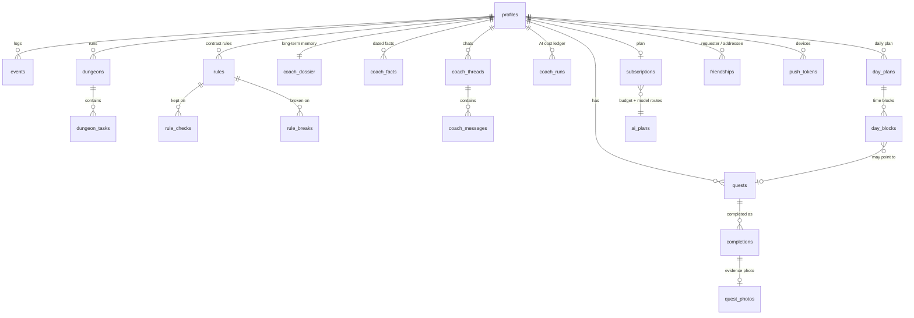

# NIVL architecture

This document describes the backend on this branch: the Postgres schema built by `supabase/migrations/0001`–`0026` and the Edge Functions in `supabase/functions/`. Table and column names are the real ones (mostly Spanish). The overview is in the [README](../README.md).

## Principles that shape the schema

- **Row-level security on all 60 tables.** Every `create table` in the migrations has a matching `enable row level security`. User-owned rows are keyed by `user_id → auth.users`.
- **The economy is server-side.** Since `0009_economia_atomica.sql`, XP is no longer written by the client as an absolute total. It goes through `SECURITY DEFINER` functions that apply atomic, idempotent deltas, and direct `UPDATE` on the economy columns is revoked. The client still computes how much a mission is worth (`src/lib/game.ts`, tested); the server bounds it and applies it.
- **Money and AI spend can only be written by the server.** `subscriptions`, `coach_runs`, the creator program tables, and functions like `record_sale` are writable only by `service_role` (the Edge Functions or admin scripts).
- **Idempotent migrations.** They use `if not exists`, `create or replace`, and guarded `cron.unschedule`, and `scripts/apply-migrations.mjs` applies only the ones that are missing.

## Data model

### Core game (0001, 0002, 0005, 0015–0017, 0019)

| Table | Purpose |
|---|---|
| `profiles` | One row per user. XP total plus five stat columns (`xp_fue`, `xp_vit`, `xp_int`, `xp_agi`, `xp_per`), `streak_days`, `last_day_processed`. Later migrations add the coach schedule (`wake_time`, `sleep_time`, `timezone`, `coach_mode`; 0008), `profile_kind` (0018/0022), and `friend_code` / `social_visible` (0021). Created by the `handle_new_user` trigger. |
| `quests` | Missions: `stat`, `difficulty`, `days_of_week`, `requires_evidence`, penalty fields. A recurring quest *is* a habit; 0015 adds `acquired_at` / `acquired_streak` when one is consolidated after 21 days. 0019 adds `link` (gym, cardio, weight, …), inferred from the title by a trigger (`infer_link`) so that logging the real activity checks off the linked mission. |
| `completions` | One per quest per day (made unique in 0011), with `xp_awarded` and `evidence_url`. |
| `events` | Append-only log of game events. |
| `dungeons`, `dungeon_tasks` | "Campaigns": multi-step projects with a boss task. |
| `rules`, `rule_checks`, `rule_breaks` | The personal contract. Since 0016, rules are checked daily and anything left unchecked at day close counts as broken. |
| `bonus_redemptions`, `letters`, `achievements` | Bonus points spent on rewards, letters to your future self, unlocked achievements. |

Economy functions: `award_xp`, `complete_quest`, `apply_day_close` (0009, reworked in 0017 so a day still counts with up to 30% of missions missed), and `award_bonus` / `redeem_bonus` (0005).

### Body, money, journal, and memories (0002, 0007, 0012–0014, 0019, 0023)

| Area | Tables |
|---|---|
| Training | `gym_days`, `gym_exercises`, `gym_sessions`, `gym_lifts`, `training_prescriptions` (coach-written), `cardio_sessions` |
| Nutrition | `meal_slots`, `shopping_items`, `nutrition_targets`, `nutrition_logs` |
| Body | `body_metrics` (weight), `body_profile` (height, injuries, equipment, experience…), `goals` |
| Money | `money_accounts`, `transactions` (deduplicated by `dedup_hash`, categorised), `category_rules`, `budgets`, `money_plan` |
| Journal | `journal_entries` (structured in 0023), `journal_photos` |
| Memories | `quest_photos` (the evidence photo doubles as a memory), `recaps` (generated weekly/monthly slide decks stored as JSON `slides`) |
| Planning | `calendar_events` |

Storage buckets (0001): `evidence` and `avatars`, each with policies that limit a user to their own `{user_id}/` folder. 0021 adds a read-only exception so friends can see each other's avatars (`is_friend_folder`).

### The coach (0008, 0010, 0014)

| Table | Purpose |
|---|---|
| `coach_dossier` | The stable, versioned long-term memory injected into every system prompt. |
| `coach_facts` | Dated facts the coach records through `registrar_hecho` (numbers, decisions, patterns). |
| `coach_threads`, `coach_messages` | Conversation history. Messages store content blocks (text, tool_use, tool_result); only the last 12 are sent back to the model. |
| `day_plans`, `day_blocks` | The day plan the coach writes: blocks with `start_min`/`end_min`, a `kind`, an optional `quest_id`, and a `notify` flag. |
| `push_tokens` | Expo push tokens per device. |
| `coach_runs` | One row per AI turn: `kind`, `model`, input / cache-read / cache-write / output tokens, `cost_micro_usd`, `error`. This ledger is what the monthly budget is checked against. |

### Plans, AI budget, and the spend lock (0006, 0020, 0024)

- `subscriptions`: `status`, `plan`, `provider` (`stripe`, `apple`, `google`, `manual`), `current_period_end`. Written only by the server.
- `ai_plans`: per plan, `tier` (`free`/`pro`/`elite`/`owner`), `monthly_budget_micro_usd`, a separate `deep_budget_micro_usd` for Élite's "deep" mode, and `routes` (JSON mapping `default`, a ritual kind, or `profundo` to a model name). Migration 0024 seeds Pro with `deepseek-v4-flash` and Élite with `claude-sonnet-5`.
- `ai_turn_locks`: one row while a user's turn is running.
- `ai_begin_turn(p_user, p_mode)`: in one transaction, checks entitlement, the remaining budget (sum of this month's `coach_runs`), and the lock. It returns `allowed`, a `reason` (`sin_suscripcion`, `presupuesto_agotado`, `turno_en_curso`, `profundo_no_incluido`, `profundo_agotado`), the turn budget, and the routes. `ai_end_turn` releases the lock. `ai_state` / `ai_status` expose the same state to the ritual worker and the app. `start_trial` gives a 7-day trial.
- `oracle_usage`: a monthly counter for the older `oracle` function (cap of 100 per month).

### Social (0021, 0026)

- `friendships` (`requester`, `addressee`, `status`) and `friend_request_log` (rate limiting). RPCs: `friend_request`, `friend_respond`, `friend_remove`, `friend_requests`, `set_friend_code`.
- `friends_board(p_days)` returns you and your accepted friends with XP gained in the window, days active, scheduled vs. completed missions, and `compliance_pct`. It respects each friend's `social_visible`, and `safe_tz` keeps one bad timezone from breaking the whole board.
- Élite groups ("ludus", 5–8 people with a shared goal): `elite_groups`, `elite_group_members`, `elite_group_requests`, with capacity and membership guard triggers and `elite_group_board`.

### Creator program (0025)

`creators`, `creator_ranks`, `creator_settings`, `referrals`, `store_products`, `store_sales`, `commissions`, `creator_payouts`. Commissions are a percentage of a fixed base per product, not of the price. `record_sale`, `record_refund` (with clawback), and `liquidate_creator` are `service_role` only. `claim_referral`, `my_referral`, `creator_panel`, and `creator_board` are the user-facing reads.

## Edge Functions

| Function | JWT | What it does |
|---|---|---|
| `coach` | verified in code (`auth.getUser`) | The agent. Spend-lock gate → layered, cached system prompt → up to 5 tool iterations over 25 tools that run with the caller's JWT → streamed reply → `coach_runs` ledger row. Also handles `clasificar` (Haiku categorises bank transactions) and `resumen` (weekly/monthly photo recap: the numbers are computed in `_shared/recap.ts` and the model only writes the text). |
| `ritual` | `--no-verify-jwt`, checks the `x-ritual-secret` header | Called hourly by pg_cron. For each profile, decides by local time whether a brief, weekly review, monthly close, or escalation is due and hasn't run yet. Skips accounts without AI or budget. Creates a short-lived session for the user (`generateLink` + verify) so the coach runs under that user's RLS, then sends an Expo push with a one-line summary. |
| `oracle` | verified in code | Older single-shot helper on Haiku: turns a goal into 3–6 recurring missions, or proposes up to 4 weekly adjustments. Requires premium and enforces `oracle_usage`. |
| `franky-auth` | `--no-verify-jwt` (caller has no session yet) | SSO bridge to Franky's separate Supabase project. Verifies credentials there, revokes that temporary session, makes sure a confirmed NIVL user exists, and returns a one-time magic-link token hash that the app redeems with `verifyOtp`. Best-effort per-IP rate limit. |
| `stripe-webhook` | `--no-verify-jwt`, Stripe signature | Maps `checkout.session.completed` and `customer.subscription.*` events onto `subscriptions`. The paywall is off by default (`EXPO_PUBLIC_PAYWALL`). |

### Shared modules (`supabase/functions/_shared/`)

| Module | Role |
|---|---|
| `anthropic.ts` | Streaming Messages API client (adaptive thinking, prompt caching), the price table, and cost in micro-dollars. `COACH_MODEL = claude-sonnet-5`, `CHEAP_MODEL = claude-haiku-4-5`. |
| `openai.ts` | Adapter for any OpenAI-compatible `/chat/completions` API. Translates Anthropic content blocks and tool calls both ways. |
| `routing.ts` | Pure module that picks the model from `ai_plans.routes` and infers the provider from the model name. Tested from `src/lib/__tests__/routing.test.ts`. |
| `prompt.ts`, `knowledge.ts` | The coach's voice and rules, per-ritual instructions, and training/nutrition domain knowledge. |
| `context.ts` | Builds the day's state: profile, missions, plan, journal, and the studies below. |
| `analytics.ts`, `finance.ts` | Deterministic studies (estimated 1RM by Epley, trends, pace, spending by category) so the model doesn't do arithmetic itself. |
| `tools.ts` | The 25 tool definitions and their executors. |
| `clasificar.ts`, `recap.ts` | Cheap Haiku transaction classifier; photo recap builder. |
| `notion.ts` | Optional mirror of ritual output to a Notion page. Only runs if `NOTION_TOKEN` is set, and only for the owner's account. |
| `db.ts` | `adminClient()` (service role) and `userClient(token)` (RLS as the caller). |

## Scheduled jobs

| Job | Schedule | Defined in |
|---|---|---|
| `nivl-rituales` → `public.disparar_rituales()` → `net.http_post` to `/functions/v1/ritual` | `0 * * * *` (hourly) | `0010_cron_rituales.sql` |

`disparar_rituales` is `SECURITY DEFINER`, revoked from `public`/`anon`/`authenticated`, and reads two Vault secrets: `nivl_ritual_secret` (generated in the database with `gen_random_bytes(32)`) and `nivl_project_url` (written by `scripts/setup-cron.mjs`, which also copies the secret into the function's `RITUAL_SECRET`). No credential is stored in the migration or the repo.
